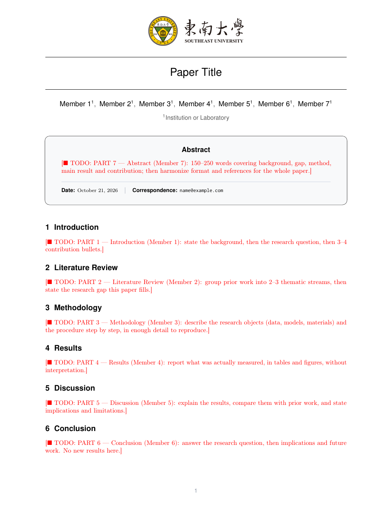

# 七部分 LaTeX 论文模板（Southeast University）

一个单栏 LaTeX 论文模板，按小组分工表的 **7 个部分**把正文拆成 7 个文件，一人一部分，互不冲突。当前是空骨架：只有标题、摘要框、各节标题和写作指引，正文留给各自成员填写。



## 七部分与分工

| # | 部分 | 文件 | 对应任务 |
|---|------|------|----------|
| 1 | Introduction | [`sections/01-introduction.tex`](sections/01-introduction.tex) | 研究背景、问题、3–4 条贡献 |
| 2 | Literature Review | [`sections/02-literature-review.tex`](sections/02-literature-review.tex) | 梳理已有研究（2–3 条主线），指出研究空白 |
| 3 | Methodology | [`sections/03-methodology.tex`](sections/03-methodology.tex) | 研究对象、步骤（可复现） |
| 4 | Results | [`sections/04-results.tex`](sections/04-results.tex) | 呈现真实得到的结果（主结果 / 消融 / 案例） |
| 5 | Discussion | [`sections/05-discussion.tex`](sections/05-discussion.tex) | 解释结果、对照前人工作、意义与局限 |
| 6 | Conclusion | [`sections/06-conclusion.tex`](sections/06-conclusion.tex) | 回答研究问题、启示与未来工作 |
| 7 | Abstract + 统稿 | [`sections/00-abstract.tex`](sections/00-abstract.tex) | 概括全文、统一格式与参考文献 |

第 7 部分不单独成节：摘要排进标题页的摘要框，统稿工作体现在 `paper.tex` 末尾的检查清单里，所以正文编号是 1–6。

## 目录结构

```
paper.tex                 入口：标题/作者/摘要框/六节的 \input/参考文献开关
uiuc_paper.cls            类文件：页面版式、标题页、摘要框、页眉校徽
macro.tex                 公共宏：\todo、\ie、\eg、\cmark、\xmark
main.bib                  BibTeX 文献库
sections/00-abstract.tex  第 7 部分（摘要，喂给标题页）
sections/01-…-06.tex      第 1–6 部分
figs/                     图片（seu-logo.png 为页眉校徽，其余为示例图）
docs/preview.png          README 用的首页效果图
archive/                  原始论文的正文与入口，仅作参考，不参与编译
00README.json             arXiv 提交元数据
```

## 编译

需要 TeX Live（2023 及以上即可），用 `pdflatex` 编译：

```bash
latexmk -pdf paper.tex     # 改动后重跑一次，让 \ref / \cite 收敛
latexmk -C                 # 清理中间文件
```

不想用 latexmk 的话：`pdflatex paper.tex && bibtex paper && pdflatex paper.tex && pdflatex paper.tex`。

需要 PDF 直接上传 arXiv 时，`paper.pdf` 已经由 `pdflatex` 生成，符合 `00README.json` 里的设置。

## 使用方式

**每个成员只改自己的文件。** 打开对应 `sections/*.tex`，文件开头有中文注释说明该部分要写什么、建议篇幅；正文里那行红字 `\todo{PART N --- ...}` 是占位，动笔时删掉它。

```latex
%% 主要任务：研究对象、步骤
\section{Methodology}
\label{sec:method}
\todo{PART 3 --- Methodology (Member 3): ...}   % ← 删掉这行，从这里开始写
```

注释掉的 `% ---- 写作骨架 ----` 段落里给了可用的 `\subsection`、booktabs 表格、图表示例，取消注释即可。

**标题与作者** 在 [`paper.tex`](paper.tex) 里改，`Member 1`…`Member 7` 按实际人数增删：

```latex
\title{Paper Title}
\author[1]{Member 1} \author[2]{Member 2} ...
\affiliation[1]{Institution or Laboratory}
```

**页眉校徽** 只在一处定义，换成别的图片改这一行即可（或在导言区 `\renewcommand`）：

```latex
\newcommand{\headerlogo}{figs/seu-logo.png}
\newlength{\headerlogoheight}\setlength{\headerlogoheight}{16mm}
```

**参考文献** 由开关控制，空骨架阶段关掉，避免出现一张空白的 References 页；正文出现第一个 `\citep` 后打开：

```latex
\newif\ifshowbib
\showbibfalse   % 改成 \showbibtrue，并确保 main.bib 里有对应的条目
```

**方法名** 全文统一用 `\method` 指代自己的方法，改名只改一处：

```latex
\newcommand{\method}{MethodName\xspace}
```

## 写作约定

- 占位用 `\todo{...}`（红字 ■），交稿前搜索 `TODO` 清干净。
- 引用用 `\citep{}` / `\citet{}`；交叉引用用 `\cref{}`（cleveref，会输出 "Section 3"、"Table 2"）。
- 表格用 `booktabs`（`\toprule` / `\midrule` / `\bottomrule`），不要竖线；图用 `subcaption`。
- 图表标题格式为 `\caption{\textbf{标签} 说明}`，`\textbf` 里的标签与正文引用保持一致。
- 源码里的中文只出现在注释中：`pdflatex` 不能直接排版中文，正文一律英文。

## 说明

- `archive/` 里是模板来源论文的正文与入口文件，保留只为对照排版；不参与 `paper.tex` 的编译，公开仓库里可以按需删除。
- 类文件仍叫 `uiuc_paper.cls`（模板的出身），与校徽无关。
- 尚未添加开源许可证，公开前请自行确定。
